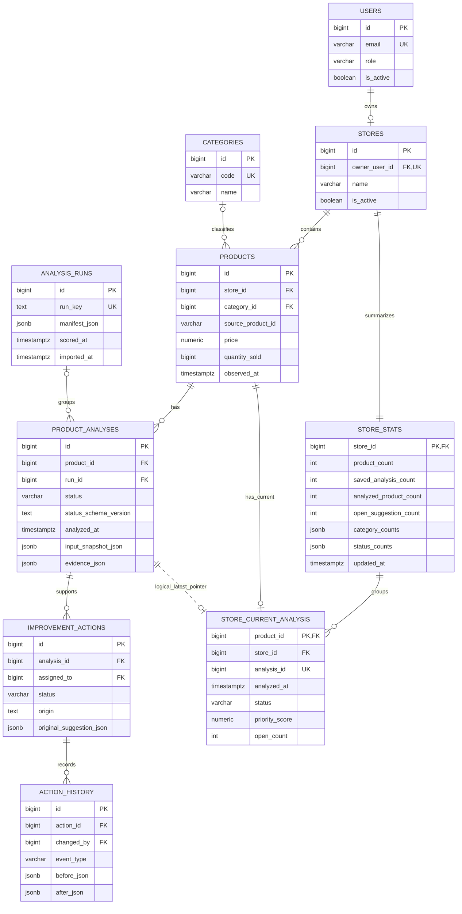

# Cơ sở dữ liệu Sellens hiện tại

Tài liệu đối chiếu schema `public` trên Neon với mã nguồn nhánh `remove_demo`. Neon ghi nhận các migration `001_shared_catalog` đến `005_store_stats`, gồm cả `003_product_media`. Phần API bên dưới mô tả mã nguồn trong repo. [Sơ đồ đề xuất trước đây](sellens-multi-store.dbml) · [Migration tổng hợp 005](../../backend/db/migrations/005_store_stats.sql)

## Sơ đồ quan hệ

Để mở sơ đồ trong dbdiagram.io, copy toàn bộ nội dung file [sellens-current.dbml](sellens-current.dbml) vào trình soạn DBML.

Mỗi tài khoản `reviewer` được hệ thống cấp một cửa hàng khi tạo. `stores.owner_user_id` là khóa ngoại có ràng buộc `UNIQUE`, nên một tài khoản sở hữu tối đa một cửa hàng. API hiển thị vai trò `reviewer` dưới tên `user`.



`PK` là khóa chính, `FK` là khóa ngoại, `UK` là ràng buộc duy nhất. Các entity chỉ hiện cột chính để dễ đọc. Đường chấm `logical_latest_pointer` biểu diễn liên kết do trigger duy trì. Trong schema vật lý, `store_current_analysis.analysis_id` có `UNIQUE` và hai khóa ngoại của bảng này là `product_id → products.id` và `store_id → store_stats.store_id`. Các khóa ngoại ghi nhận người thao tác được liệt kê bên dưới.

## Công dụng của từng bảng

| Bảng | Dữ liệu và ý nghĩa |
| --- | --- |
| `users` | Tài khoản, vai trò, trạng thái hoạt động và mật khẩu đã băm. Chỉ mục duy nhất trên `lower(email)` phục vụ tra cứu email đăng nhập. |
| `stores` | Hồ sơ cửa hàng và chủ sở hữu. `owner_user_id` liên kết tới `users.id`. Trigger chặn đổi chủ cửa hàng và chặn đổi `store_id` của sản phẩm đã lưu. |
| `categories` | Danh mục dùng chung theo `code`, ví dụ giày hoặc túi. Sản phẩm có thể chưa phân loại. |
| `products` | Dữ liệu sản phẩm hiện tại theo cửa hàng, gồm giá, số bán quan sát, đánh giá, ảnh và video. `source_system` và `source_product_id` hỗ trợ đối chiếu dữ liệu nguồn. `imported_by` ghi tài khoản nhập nếu có. `quantity_sold` có thể rỗng khi dữ liệu nguồn chưa cung cấp. |
| `analysis_runs` | Thông tin một đợt nhập kết quả phân tích, gồm `run_key`, dấu vân tay dữ liệu nguồn và tập mẫu, manifest, thời điểm chấm và thời điểm nhập. Một đợt nhập offline có thể chứa kết quả của nhiều sản phẩm. Tác vụ ML theo yêu cầu tạo một đợt cho mỗi sản phẩm, với khóa yêu cầu trong `run_key`, dấu vân tay đầu vào trong `source_sha256` và dấu vân tay đầu ra trong `selection_sha256`. |
| `product_analyses` | Mỗi dòng là một kết quả phân tích của một sản phẩm. Lưu mức tham chiếu, chênh lệch, trạng thái, phiên bản và các JSON cố định tại thời điểm chạy. `run_id` và `analyzed_by` có thể rỗng. Cặp `(run_id, product_id)` duy nhất khi có `run_id`. Phân tích lại tạo mốc mới. |
| `improvement_actions` | Đề xuất và công việc của một lần phân tích. Lưu nội dung gốc trong `original_suggestion_json`, phần theo dõi ở `status`, `assigned_to`, ghi chú và thời hạn. `assigned_to` và `created_by` tham chiếu `users` khi có. Chỉ mục duy nhất theo `(analysis_id, rule_id)` áp dụng cho đề xuất ML có `origin = 'ml_rule'`. |
| `action_history` | Nhật ký thêm mới của công việc, gồm sự kiện, người thao tác trong `changed_by`, thời điểm và JSON trước/sau. API ghi nhật ký cùng giao dịch với thao tác công việc. |
| `store_stats` | Một dòng số liệu hiện tại mỗi cửa hàng, gồm tổng sản phẩm, tổng kết quả đã lưu, số sản phẩm đã phân tích, có tham chiếu, cần rà soát, các số đếm đề xuất và phân bố JSON theo danh mục hoặc trạng thái. |
| `store_current_analysis` | Một dòng tóm tắt hiện tại cho mỗi sản phẩm đã phân tích. Lưu ID mốc mới nhất, thời điểm, trạng thái, điểm ưu tiên và số đề xuất thuộc mốc đó để cập nhật số đếm và đọc danh sách ưu tiên. |

Neon còn có sáu bảng vận hành:

| Bảng | Công dụng hiện tại |
| --- | --- |
| `sellens_sessions` | Phiên đăng nhập theo giá trị băm của token, có `user_id` và thời hạn. Backend xác thực phiên và trạng thái tài khoản cho các API cần đăng nhập. |
| `sellens_login_limits` | Bộ đếm số lần thử đăng nhập và thời điểm bắt đầu cửa sổ giới hạn. |
| `sellens_migrations` | Sổ phiên bản schema. Mỗi dòng lưu tên migration, checksum và thời điểm áp dụng. |
| `sellens_seed_records` | Danh mục các bản ghi seed theo `seed_key`. `entity` và `record_id` dùng để nhận diện mẫu theo loại bảng. |
| `import_batches` | Bảng metadata đợt nhập có trên Neon, chứa tên file, số dòng và lỗi tổng hợp. `imported_by` là khóa ngoại tùy chọn tới `users`. Luồng import CSV/JSON trong mã nguồn hiện ghi qua `products` và trả báo cáo trong response. |
| `notifications` | Bảng thông báo có trên Neon, gồm tiêu đề, nội dung, liên kết và cờ đã đọc. `user_id` là khóa ngoại tùy chọn tới `users`. Trong mã nguồn hiện tại, menu thông báo dùng trạng thái giao diện. |

Trạng thái phân tích lưu theo hai phiên bản `legacy_v1` và `ml_v2`. Trạng thái công việc gồm `proposed`, `accepted`, `in_progress`, `completed`, `rejected` và `cancelled`. Hai nhóm trạng thái phục vụ hai mục đích khác nhau. Trạng thái phân tích là kết luận đã lưu, còn trạng thái công việc phản ánh tiến độ xử lý. [Ràng buộc ML](../../backend/db/migrations/002_ml_sample.sql) · [Dịch vụ công việc](../../backend/src/server/services/actions.ts)

## Các luồng ghi dữ liệu

1. **Tạo tài khoản và cửa hàng.** Trigger `user_store` tạo cửa hàng cho vai trò `reviewer`. Khi cửa hàng được tạo, `init_store_stats` khởi tạo số đếm bằng 0.
2. **Import sản phẩm.** Backend lấy cửa hàng đang hoạt động từ phiên đăng nhập, khóa cửa hàng trong giao dịch import và đối chiếu mã sản phẩm trong phạm vi đó. Thêm mới tăng `product_count`. Sửa dữ liệu của sản phẩm đã có giữ nguyên tổng. Đổi danh mục chuyển một đơn vị giữa hai nhóm danh mục.
3. **Lưu kết quả phân tích.** Snapshot đầu vào, bằng chứng và dữ liệu so sánh được ghi vào `product_analyses`. Trigger xét thứ tự `analyzed_at DESC, id DESC` để duy trì mốc mới nhất. Nhập một mốc cũ làm tăng tổng số kết quả đã lưu. Mốc hiện tại chỉ đổi khi mốc được nhập xếp mới hơn, hoặc khi thao tác bảo trì hợp lệ xóa mốc hiện tại.
4. **Cập nhật đề xuất.** Thay đổi trạng thái công việc cập nhật số đếm trong cùng giao dịch. Tổng quan đếm công việc từ **mốc mới nhất của mỗi sản phẩm**. `open_suggestion_count` gồm `proposed`, `accepted` và `in_progress`. `pending_review_count` chỉ đếm `proposed` ở các mốc mới nhất. `proposed_count` dùng ở thanh bên, đếm `proposed` từ mọi mốc của cửa hàng.

Migration 005 tính số liệu ban đầu từ dữ liệu gốc. Từ đó, các trigger ghi phần chênh lệch vào dòng tổng hợp của cửa hàng. Hai thao tác ghi cần cập nhật cùng dòng số liệu sẽ lần lượt lấy khóa dòng. Nếu giao dịch bị hoàn tác, số đếm và thao tác gốc cùng quay về trạng thái trước đó. [Import](../../backend/src/server/services/imports.ts) · [Migration 005](../../backend/db/migrations/005_store_stats.sql)

## Cách các màn hình truy vấn

Backend lấy ID tài khoản từ phiên đăng nhập. Luồng đọc của User đi theo `users.id → stores.owner_user_id → products.store_id`, có kiểm tra cửa hàng đang hoạt động. Khi mở một kết quả cũ, backend còn kiểm tra ID lần phân tích thuộc đúng sản phẩm. Admin có quyền xem tài khoản, hồ sơ cửa hàng và số liệu tổng hợp. Chi tiết sản phẩm, snapshot phân tích và đề xuất nằm trong phạm vi truy cập của chủ cửa hàng. [Xác thực](../../backend/src/server/auth.ts) · [Điều phối API](../../backend/src/server/api.ts)

| Màn hình / API | Truy vấn và lý do tối ưu |
| --- | --- |
| **Tổng quan User** — `GET /api/v1/workspace/overview` | Đọc một dòng `store_stats`, lấy tên của các danh mục đã đếm và xem mốc hiện tại qua `store_current_analysis`. Một response trả số liệu cả cửa hàng, tối đa **8 sản phẩm ưu tiên** và **4 thẻ đề xuất**. Chỉ mục ưu tiên theo cửa hàng và điểm hỗ trợ lấy các dòng đứng đầu. [Truy vấn Tổng quan](../../backend/src/server/services/overview.ts) |
| **Danh mục User** — `GET /api/v1/products?view=catalog` | Lọc theo cửa hàng, từ khóa và danh mục, xác định trạng thái mới nhất để áp dụng lọc/sắp xếp, rồi phân trang trên server. Gửi các trường hiển thị và tiêu đề đề xuất của các dòng trên trang. `products_store_category` hỗ trợ thu hẹp phạm vi. Khi sắp xếp theo trạng thái, chi phí tìm mốc mới nhất vẫn phụ thuộc số sản phẩm khớp bộ lọc. [Truy vấn Danh mục](../../backend/src/server/services/catalog.ts) |
| **Kết quả phân tích User** — `GET /api/v1/analysis-workspace` | Với một sản phẩm, chỉ lấy ID, thời gian và số bán từ snapshot của các mốc trong khoảng ngày Việt Nam đã chọn. Trả chi tiết và đề xuất của mốc mới nhất trong khoảng. Khi bấm mốc cũ, gọi `GET /api/v1/products/:id/analyses/:analysisId` để lấy chi tiết đúng mốc. Chỉ mục `analyses_product_time` hỗ trợ tìm theo sản phẩm và thời gian. [Truy vấn Phân tích](../../backend/src/server/services/analyses.ts) |
| **Cửa hàng Admin** — `GET /api/v1/stores` | Đọc số sản phẩm từ `store_stats`. Hai chỉ mục `store_stats_most_products` và `store_stats_fewest_products` phục vụ hai chiều sắp xếp. Khi số đếm bằng nhau, `store_id` tăng dần quyết định thứ tự. API trả tối đa **50 cửa hàng** cho trang mặc định của UI. Khi tìm theo tên hay mã, áp dụng điều kiện tìm trước khi phân trang. Ô tổng lấy tổng số cửa hàng và số sản phẩm đã lưu trong bảng tổng hợp. [Truy vấn cửa hàng](../../backend/src/server/services/stores.ts) |
| **Tổng quan / Giám sát / Cấu hình Admin** — `GET /api/v1/admin/summary?view=…` | Tổng quan cộng `product_count` và `saved_analysis_count` từ các dòng `store_stats`. Giám sát gom hoạt động theo cửa hàng và đợt phân tích, lấy tối đa 20 mục gần nhất. Cấu hình tổng hợp các tổ hợp phiên bản đã chạy. Mỗi màn hình yêu cầu phần dữ liệu tương ứng. [Truy vấn Admin](../../backend/src/server/services/admin-summary.ts) |
| **Đề xuất cải thiện User** — `GET /api/v1/actions` | Backend giới hạn theo cửa hàng qua `improvement_actions → product_analyses → products`. Chế độ `view=cards` áp dụng bộ lọc và sắp theo `updated_at DESC, id DESC` trước khi lấy 20 thẻ. Gói phản hồi có tên và ảnh sản phẩm cùng các số đếm. Danh sách và Kanban dùng chung trang đang xem. Bộ chọn phân tích và lịch sử chỉ tải khi mở hộp thoại. [API công việc](../../backend/src/server/services/actions.ts) · [Luồng tải giao diện](../../frontend/src/page/user/suggestion.tsx) |

## Ví dụ về phần tối ưu

Truy vấn dưới đây minh họa đường đọc top 50 của Admin khi ô tìm kiếm trống. B-tree `store_stats_most_products` đã lưu các giá trị theo đúng thứ tự nên PostgreSQL có thể dừng phần đọc bảng xếp hạng khi đủ 50 dòng.

```sql
SELECT store_id, product_count
FROM store_stats
ORDER BY product_count DESC, store_id ASC
LIMIT 50;
```

Trước migration, truy vấn xếp hạng phải gom các dòng `products` theo cửa hàng, đếm rồi chọn top 50. Trên Neon, hai lần đo trước và sau migration ghi nhận khoảng **34,7 ms và 2,7 ms** cho trang đầu khi sắp theo nhiều sản phẩm nhất. Kế hoạch sau migration dùng `store_stats_most_products`. Đây là thời gian thực thi trong PostgreSQL ở từng lần đo. Phép đo thời gian tải toàn trang dưới tải thực tế vẫn là một việc riêng. [Kết quả kiểm chứng](../CURRENT_STATE.md#current-store-statistics)

Đổi lại, mỗi thay đổi liên quan đến số đếm có thêm thao tác ghi. Tổng quan được đọc nhanh vì phần tính toán đã chuyển sang lúc thay đổi dữ liệu. Danh mục và danh sách cửa hàng đang dùng phân trang `LIMIT`/`OFFSET`. Nếu các trang sâu trở thành điểm chậm, có thể đo rồi cân nhắc cursor theo cột sắp xếp và ID.

## Cách đối chiếu khi schema thay đổi

- Dùng `information_schema.columns`, `pg_constraint`, `pg_indexes` và `pg_trigger` để kiểm tra schema thực tế trên Neon. Dùng `sellens_migrations` để đối chiếu phiên bản đã áp dụng.
- Đọc các file migration và dịch vụ API tương ứng trước khi sửa hợp đồng dữ liệu. Neon ghi nhận `003_product_media`, còn file SQL gốc của migration đó chưa có trong checkout này. Các cột media trong tài liệu được đối chiếu trực tiếp từ Neon.
- Tham khảo [hợp đồng dữ liệu](../rules/data-contracts.md), [quyết định bảng tổng hợp](../decisions/0011-current-store-statistics.md) và [hướng dẫn backend](../../backend/README.md).
