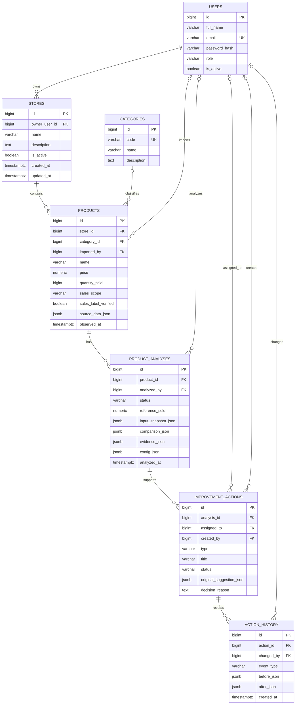

# Proposed Sellens multi-store schema

Date: 2026-10-14 (Asia/Saigon). Status: reviewable proposal, not applied.
Input: [original supplied DBML](sellens-shared-catalog.dbml).
New direct instruction: one User owns multiple stores; each store contains products.
Existing ML exports remain unused; no import/inference work is added.

## Relationships

An account is the login/owner identity, and a store is a separate business record.
`users -> stores -> products -> product_analyses -> improvement_actions -> action_history`.
One User can have zero or more stores; each store has exactly one owner. Each
product/listing belongs to exactly one store after legacy assignment is complete.
If the same merchandise appears in two stores, create two product/listing records,
with separate prices, observed sales, analyses and actions. No many-to-many store/
product mapping is needed for this interpretation.

Categories remain shared metadata. Keep imported_by/analyzed_by/assigned_to/
created_by/changed_by as actor references; none substitutes for store ownership.
The original account enum is retained: database reviewer is API user. Admin remains
the management role. Do not infer application ownership from CSV seller metadata.



This diagram shows key fields; [complete DBML](sellens-multi-store.dbml) preserves
every original core field/enum plus stores/store_id. Auxiliary session/throttle/
seed/migration tables remain as implemented and are omitted from the domain diagram.
Mermaid/DBML are documentation; PostgreSQL executes SQL, not these diagrams.

## SQL for the existing Neon database

1. Inspect existing schema and confirm `stores` / `products.store_id` do not already
   exist. The one-time proposal stops atomically on name conflicts; no replacement.
2. Run [002_user_stores.sql](../../backend/db/proposals/002_user_stores.sql) in the
   Neon SQL Editor. It adds stores, nullable product store_id, foreign keys/indexes
   and guards preventing later product moves or store-owner transfers.
3. Create stores using actual persisted user IDs and explicitly choose product IDs
   for each store. No stores/owners are guessed and no seed rows are overwritten.
4. Update API authorization, UI store selection, create paths and seed logic.
5. Only after all products are assigned and create paths support store_id, run
   [003_require_product_store.sql](../../backend/db/proposals/003_require_product_store.sql).
   It refuses to proceed if any product is unassigned, then enforces NOT NULL.

SQL editor assignment pattern below is commented intentionally. Replace IDs/names
with reviewed real values before executing; choose exact products, not every row.

```sql
-- BEGIN;
-- INSERT INTO stores (owner_user_id, name, description)
-- VALUES (REAL_USER_ID, 'REAL_STORE_NAME', 'REAL_DESCRIPTION') RETURNING id;
-- UPDATE products SET store_id = RETURNED_STORE_ID, updated_at = now()
-- WHERE id IN (EXPLICIT_PRODUCT_IDS) AND store_id IS NULL;
-- COMMIT;
```

These proposal scripts are not applied and are not included in the current
`npm run db:migrate`, which only handles the existing 001 migration. The applied
001 file/checksum and all existing data remain unchanged. PostgreSQL runtime
verification is pending; only paths, diagram/schema correspondence and SQL text
were checked in this design session.

## Application changes still required

Current backend/frontend still read the shared catalog. Adding SQL does not
automatically restrict user access. Before claiming private-store support, implement
store CRUD/listing/selection, server-side ownership checks on products and all
nested analyses/actions/history, store-scoped aggregation and strict store_id input
validation. Unassigned legacy products must be inaccessible to regular Users.
Verify two Users with multiple stores and cross-owner direct-ID denial. Action
assignees/actors must be authorized for the original product's store; admin remains
explicit system-wide management. Suspended owners/inactive stores cannot grant access.

Product store and store owner remain fixed after assignment to preserve original
ownership of historical results. Archive/deactivate instead of deleting referenced
stores. Historical analyses/actions/evidence are not rewritten. Future product
movement or store transfer needs a separate reviewed workflow; no silent reassignment.
